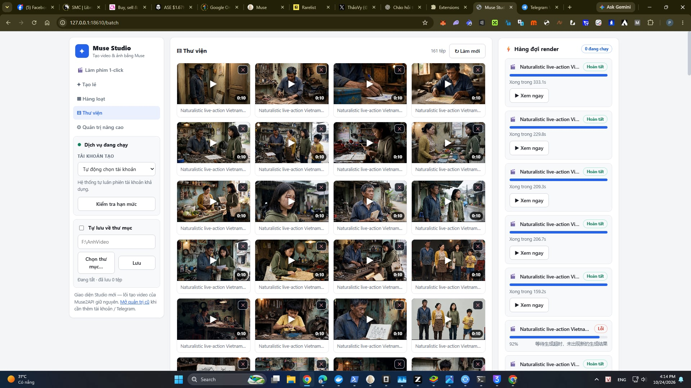

# Muse Studio — Làm phim AI 1-click bằng tiếng Việt

Nạp kịch bản, bấm **1 nút duy nhất** — Muse Studio tự tạo cảnh, tự lồng tiếng Việt, tự sinh nhạc nền, tự cắt ghép thành **một bộ phim hoàn chỉnh** để xem ngay hoặc đăng YouTube/Facebook/TikTok. Chạy ngay trên máy Windows của bạn, **miễn phí 100%**.

---

# ⬇️ TẢI NGAY — chỉ 1 file duy nhất, bấm là tải

## ⬇️ [Muse-Studio-Tron-Goi-v1.zip](https://github.com/binance9/muse-studio/releases/download/tron-goi-v1/Muse-Studio-Tron-Goi-v1.zip) (~164 MB)

**Chỉ cần tải đúng 1 file này.** Trong gói đã có sẵn mọi thứ — bộ chạy tạo ảnh/video (giao diện Muse Studio đã gắn sẵn), bộ cắt ghép phim, dịch vụ dựng phim, cả bộ cài Python — **không phải đi tải thêm ở bất cứ đâu khác**.

> Mã kiểm tra cho người rành kỹ thuật (SHA-256): `ab1763609f611e1ec7df9bc7843e91f17e370ae29bb10149885e7b242e32cc58`

Cài xong, giao diện sẽ trông như thế này:



---

## Chuẩn bị — đọc 30 giây

- Máy **Windows 10 hoặc 11 (64-bit)**, có **Google Chrome** (hoặc Microsoft Edge).
- Một **tài khoản muse.ai miễn phí của chính bạn**: vào https://muse.ai, đăng ký bằng email/Google, mất khoảng 1 phút. Tuyệt đối không mua tài khoản của người khác bán.
- Ổ cứng trống khoảng **10 GB**, Internet ổn định.
- **Miễn phí 100%, không có key nào phải mua.** Ai đòi tiền bán key, bán tài khoản, thu tiền "cài hộ" đều là **lừa đảo**. Không bao giờ gửi cho bất kỳ ai: mật khẩu muse.ai, file `.env`, hay cookie đăng nhập của bạn — ai có những thứ đó là chiếm được tài khoản của bạn.

---

## Cài đặt — làm đúng thứ tự 1 → 5, đừng nhảy bước

### Bước 1 — Giải nén gói trọn gói

1. Mở thư mục **Downloads**, chuột phải vào file `Muse-Studio-Tron-Goi-v1.zip` → **Extract All…** → **Extract**.
2. Bạn sẽ được một thư mục tên **`Muse-Studio-Tron-Goi`**. Mở nó ra, bên trong có sẵn: file hướng dẫn `HUONG_DAN_CAI_DAT.txt` (chính là các bước dưới đây), file cài Python, và thư mục `muse2api-test`. Để nguyên như vậy, làm tiếp Bước 2.

### Bước 2 — Cài Python bằng file có sẵn trong gói (chỉ làm 1 lần)

1. Trong thư mục `Muse-Studio-Tron-Goi`, nhấp đôi vào file **`1_CAI_PYTHON_NEU_CHUA_CO.exe`**.
2. Ở màn hình đầu tiên, **tick vào ô "Add python.exe to PATH"** → bấm **Install Now** → cài xong bấm **Close**.
3. Máy nào đã có sẵn Python 3.12 rồi thì bỏ qua bước này.

### Bước 3 — Đặt thư mục vào ổ C:, mở chương trình, thêm tài khoản

1. **Cắt (Cut)** thư mục `muse2api-test` trong gói, **dán (Paste)** vào ổ **C:**. Kiểm tra đường dẫn cho đúng thế này là đạt:
   ```
   C:\muse2api-test\app\Muse2API_VI_Portable_1.6.8\Muse2API_Studio.exe
   ```
2. Mở thư mục đó, nhấp đôi vào **`Muse2API_Studio.exe`**. Nếu Windows hiện màn hình xanh SmartScreen thì bấm **More info → Run anyway**. Chờ chương trình mở lên.
   - Nếu mở EXE mà báo lỗi **"Failed to load Python DLL … python312.dll"**: nghĩa là giải nén chưa hết (thư mục `_internal` bên cạnh EXE bị thiếu) hoặc đã chép EXE ra chỗ khác. Xóa thư mục đó đi, giải nén lại gói trọn gói **toàn bộ** và chạy EXE ngay trong thư mục của nó.
3. **Thêm tài khoản muse.ai của bạn:** làm theo từng dòng trong file **`HUONG_DAN_1.6.8.txt`** nằm ngay trong thư mục chương trình. Chương trình sẽ mở trình duyệt để bạn tự đăng nhập — chỉ nhập mật khẩu trên trang muse.ai chính thức, không nhập ở bất kỳ chỗ nào khác.
4. **Lấy API key của bạn:** mở file **`.env`** trong cùng thư mục (mở bằng Notepad), tìm dòng bắt đầu bằng `KEY=` — phần chữ phía sau dấu `=` là API key. Ghi lại ở nơi riêng tư, **không gửi cho ai**.
5. **Kiểm tra:** mở Chrome, vào địa chỉ **http://127.0.0.1:18610** — thấy trang quản trị hiện lên là xong Bước 3. **Để nguyên chương trình này chạy**, đừng tắt, trong suốt lúc làm phim.

### Bước 4 — Chạy dịch vụ dựng phim (1 cú bấm đôi)

1. Mở thư mục `C:\muse2api-test\film-service\`, nhấp đôi vào file **`CHAY_DICH_VU_DUNG_PHIM.bat`**. Một cửa sổ đen sẽ mở ra và chạy dịch vụ.
2. **Kiểm tra:** mở thêm một tab Chrome vào **http://127.0.0.1:18621/health** — thấy `{"ok": true, ...}` là dịch vụ khỏe. **Giữ cửa sổ đen này mở** suốt lúc làm phim.
   - Giọng lồng tiếng: dịch vụ tự dùng giọng đọc trực tuyến có sẵn — **không cần cài thêm bất cứ thứ gì**.

### Bước 5 — Mở Muse Studio và làm bộ phim đầu tiên

1. Mở Chrome, vào địa chỉ sau, thay `KEY_CUA_BAN` bằng API key bạn đã lấy ở Bước 3:
   ```
   http://127.0.0.1:18610/batch?key=KEY_CUA_BAN
   ```
   Chỉ cần mở bằng địa chỉ có key **đúng 1 lần đầu tiên** — Studio sẽ tự nhớ cho các lần sau.
2. Thấy giao diện Muse Studio với menu bên trái (🎬 Làm phim 1-click · Tạo lẻ · Hàng loạt · Thư viện) là **cài xong**.
3. Vào tab **🎬 Làm phim 1-click**. Tập thử bằng kịch bản mẫu có sẵn trong Studio trước. Kịch bản tự viết thì theo đúng mẫu này — mỗi cảnh gồm 1 dòng `CANH:` và các dòng `THOAI:` ngay dưới nó, giữa các cảnh cách nhau **1 dòng trống**:
   ```
   CANH: <mô tả cảnh bằng tiếng Anh — góc máy, nhân vật, hành động, bối cảnh, ánh sáng>
   THOAI: <Tên nhân vật>: <câu thoại tiếng Việt>

   CANH: <cảnh tiếp theo>
   THOAI: <Tên nhân vật>: <câu thoại>
   ```
   Một tập phim nên có khoảng **10–15 cảnh**, mỗi cảnh quay 10 giây.
4. Muốn nhân vật giống nhau xuyên suốt phim: điền mô tả dàn nhân vật vào ô **Ảnh định trang nhân vật** và bấm nút tạo ảnh định trang trước — hoặc tải ảnh mẫu của bạn lên và đặt vai trò *Nhân vật*. Chọn chế độ khóa:
   - Phim **người thật** → chế độ **Người thật**.
   - Phim **thú / hoạt hình** → chế độ **PRO**.
5. Bấm **▶ LÀM PHIM** và chờ. Trong lúc chạy, **đừng tắt** 3 thứ: chương trình ở Bước 3, cửa sổ đen ở Bước 4, và tab Studio. Mạng nghẽn là bình thường — tool tự thử lại nhiều lần, cảnh nào xong là lưu ngay; nếu phải dừng giữa chừng, cứ bấm **▶ LÀM PHIM** lại, tool chạy tiếp từ cảnh còn thiếu.
6. **Phim xong** sẽ nằm trong Studio → **Thư viện** → mục **🎬 Phim đã hoàn thành**: xem ngay trong app, ưng rồi mới bấm **⬇ Tải xuống** để lưu về máy. File gốc cũng có sẵn ở `C:\muse2api-test\film-service\outputs\`.

---

## Mỗi lần làm phim tiếp theo — chỉ 1 cú bấm đôi

Mở thư mục `C:\muse2api-test\`, nhấp đôi vào file **`MO_MUSE_STUDIO.bat`** — file này tự mở cả chương trình chính, dịch vụ dựng phim và trang Studio cho bạn. Việc còn lại chỉ là làm phim.

---

## Lỗi thường gặp

| Hiện tượng | Nguyên nhân | Cách xử lý |
|---|---|---|
| Mở EXE báo "Failed to load Python DLL … `python312.dll`" | Giải nén gói chưa hết (thiếu thư mục `_internal` cạnh EXE), hoặc chép EXE ra chỗ khác một mình | Xóa thư mục đó, giải nén lại gói trọn gói **toàn bộ**, chạy EXE ngay trong thư mục của nó ở `C:\muse2api-test\app\Muse2API_VI_Portable_1.6.8\` |
| Studio hiện màn hình bắt nhập API key | Chưa từng mở bằng địa chỉ có `?key=` | Mở lại `http://127.0.0.1:18610/batch?key=KEY_CUA_BAN` đúng 1 lần (Bước 5) |
| Vào `127.0.0.1:18610` không thấy gì | Chương trình chính chưa mở hoặc đã bị tắt | Mở lại `Muse2API_Studio.exe` (Bước 3), đợi khởi động xong rồi F5 |
| Vào `127.0.0.1:18621/health` không mở được | Dịch vụ dựng phim chưa chạy | Nhấp đôi lại `CHAY_DICH_VU_DUNG_PHIM.bat` trong `C:\muse2api-test\film-service\` (Bước 4); nếu cửa sổ đen báo lỗi thì đọc dòng lỗi trong đó |
| Một cảnh báo lỗi "hết thời hạn chờ" rồi dừng | Phía muse.ai đang nghẽn, xảy ra thường xuyên | Không sao: cảnh đã xong đã được lưu. Bấm **▶ LÀM PHIM** lại, tool chạy tiếp cảnh còn thiếu |
| Tất cả các cảnh đều lỗi liên tục | Đăng nhập tài khoản muse đã hết hạn (thường vài ngày) hoặc hết hạn mức tuần | Thêm lại tài khoản muse của bạn (Bước 3); hạn mức tuần tự hồi theo lịch của muse.ai |
| Phim dựng xong nhưng không có tiếng | Thiếu file cắt ghép phim (giải nén thiếu), hoặc dịch vụ dựng phim chưa chạy lúc dựng | Kiểm tra đủ `ffmpeg.exe` + `ffprobe.exe` ở `C:\muse2api-test\ffmpeg\bin` — thiếu thì giải nén lại gói trọn gói; kiểm tra `/health` (Bước 4), rồi dựng lại |
| Tạo **ảnh** khóa cho nhân vật người thật bị từ chối | Bên tạo ảnh không nhận ảnh người thật làm khung khóa | Dùng chế độ **Người thật** thay cho chế độ PRO khi làm phim người thật |
| Phim xong nhưng không thấy ở đâu | — | Studio → **Thư viện** → **🎬 Phim đã hoàn thành**; hoặc mở thư mục `C:\muse2api-test\film-service\outputs` |

---

## Giữ an toàn cho tài khoản của bạn

- File **`.env`**, thư mục **`data`** và cookie đăng nhập chứa toàn bộ quyền vào tài khoản muse của bạn. **Không gửi, không chia sẻ, không đăng lên mạng** — kể cả "gửi để người ta xem lỗi hộ". Cần chụp màn hình lỗi thì che phần key đi.
- Mọi thứ chỉ chạy trên máy của bạn (`127.0.0.1`), không ai từ Internet vào được — đừng tự mở cổng ra ngoài.
- Nghi ngờ đã lộ key: đổi dòng `KEY=` trong file `.env`, khởi động lại chương trình chính, mở lại Studio bằng địa chỉ có key mới.

## Lưu ý nhỏ

- Muốn **đổi chữ ký mặc định trên phim** thành tên của bạn: mở file `batch.html` trong thư mục chương trình tìm chữ `by prompt Thaovy19T` và sửa — chỉ có 1 chỗ. File gốc của chương trình đã được giữ lại ở `batch.html.goc.bak` nếu muốn quay lại.
- Làm phim nhiều cảnh luôn dùng chế độ **độc lập (independent)** — Studio đã mặc định sẵn như vậy, đừng đổi sang chế độ đồng bộ.
- Mỗi cảnh quay tối đa 10 giây — hãy chia kịch bản thành nhiều cảnh ngắn thay vì một cảnh dài.

---

Giấy phép **MIT** (xem file `LICENSE` kèm theo) — dùng, sửa, chia sẻ lại miễn phí.

*Chúc bạn làm được nhiều bộ phim hay — miễn phí, tự tay làm, không mất tiền oan cho ai cả.*
